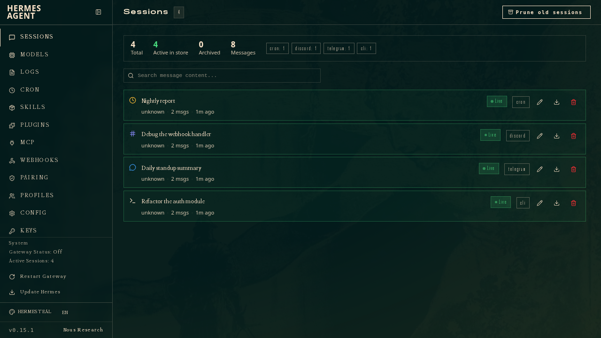
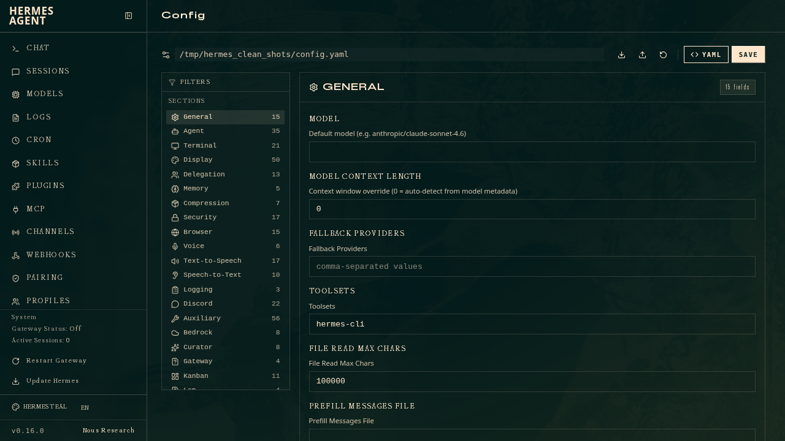
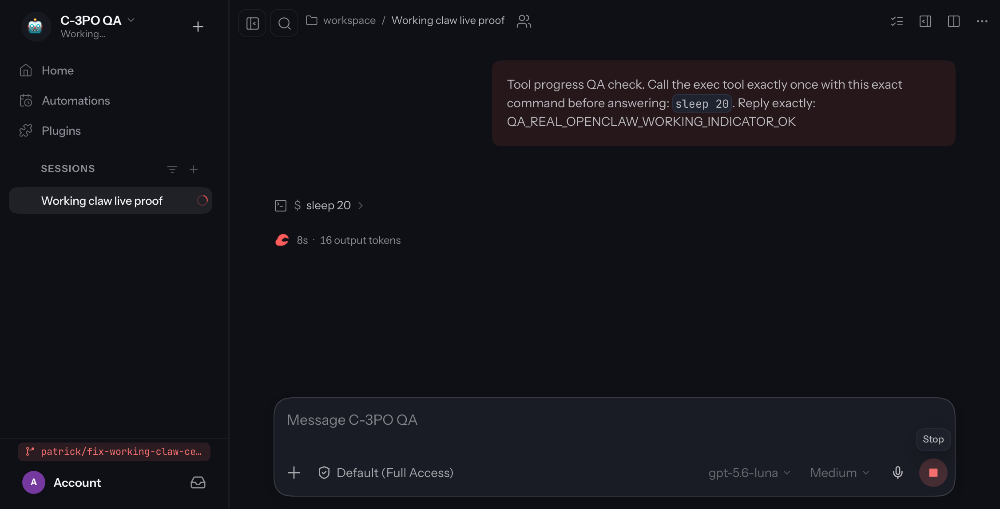
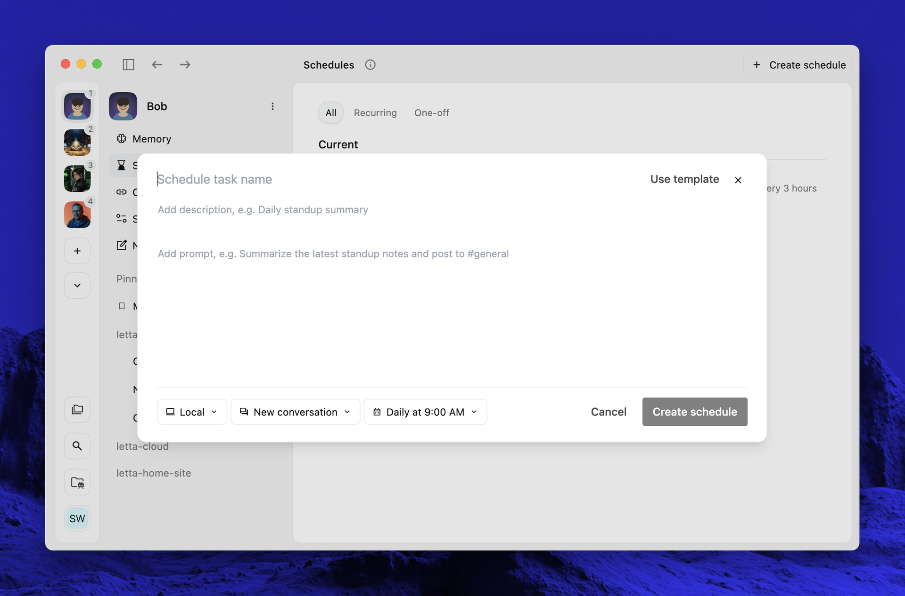

# Self-hosted personal agents: can Hermes replace Empress?

> [!NOTE]
> **Status:** DRAFT · **Authoring:** AI-assisted; deployment and failure tests pending.

**Snapshot: 2026-10-10.** Goal: reliable task execution on your own infrastructure, with useful email triage as a second use case. This is a researched architectural evaluation, not a deployment benchmark. No personal mailbox was connected and no existing Empress feature was removed.

## Recommendation

Pilot **Hermes** first for an operator-friendly personal agent. Compare **OpenClaw** when email triggers and channel operations dominate. Choose **Letta App Server** when you want to build and own the task controller. Keep Empress until a candidate passes the failure tests below. Memory, a dashboard, and tool access alone do not establish workflow parity.

“Smartness” depends on the configured model, available context, and tool quality. Compare candidates using the same model and task packet before attributing differences to the harness. Then test the best model each supports separately. A smarter model cannot repair duplicate side effects or an incorrect completion state by itself.

## Three different self-hosting decisions

| Layer | What you control | What can still leave your machine |
| --- | --- | --- |
| Agent runtime | Process, tools, filesystem, worker isolation | Tool traffic and cloud inference requests |
| Agent state | History, memory, jobs, task ledger, backups | Hosted backend or integration storage if selected |
| Model inference | Local weights and runtime, or a provider account | A cloud model receives the supplied messages and attachments |

Hermes documents local-model and compatible-endpoint options. Letta explicitly distinguishes `--backend local` from cloud state. Running a terminal command on your server is not sufficient evidence that memory stays there. [Hermes local models](https://hermes-agent.nousresearch.com/docs/user-guide/local-models), [Letta App Server](https://docs.letta.com/self-hosting/app-server).

For the first pilot, use one isolated Linux VM, persistent storage, a supervised service, and a known model endpoint. No GPU is needed for API inference. Local-model hardware depends on weights, quantisation, context, and concurrency; no universal RAM estimate is claimed. Back up state and restore it onto a clean VM before trusting an unattended deployment. See [declarative infrastructure](../practices/declarative-infrastructure.md) for the deployment ownership model.

## Capability and reliability comparison

Legend: **documented** means a primary source describes the capability; **build/test** means additional integration or acceptance work remains. Neither means reliability has been measured here.

| Requirement | Hermes | OpenClaw | Letta App Server |
| --- | --- | --- | --- |
| Runtime on your server | Documented | Documented | Documented |
| Persistent agent state | Home/profile state and session storage | Gateway/session/workspace state | Explicit local backend or cloud backend |
| Operator UI | Web dashboard, TUI, Desktop | Browser Control UI and companion apps | App, CLI, and App Server APIs |
| Scheduling | Cron definitions and execution ledger | Cron/event automation and recovery semantics | App scheduling; custom controller integration needs testing |
| Recovery of ambiguous side effects | Interrupted cron attempts can become `unknown`, without blind retry | Recovery does not promise exactly-once external effects | Application owns durable outcomes and retry policy |
| Email path | Dedicated IMAP/SMTP agent inbox; separate mailbox tools | Gmail PubSub and IMAP event paths | Integration work; no turnkey triage claim verified |
| Empress task contract | Build/test | Build/test | Build/test, with explicit controller tools |
| Best fit | Personal operator workflow | Event/channel automation | Custom durable application |

Sources: [Hermes cron](https://hermes-agent.nousresearch.com/docs/user-guide/features/cron/), [OpenClaw scheduling release](https://docs.openclaw.ai/releases/2026.8.1/automations-and-scheduling), [Letta integration patterns](https://docs.letta.com/self-hosting/app-server/integration-patterns).

### Hermes

Hermes is the closest first experiment because its dashboard, tools, profiles, and scheduler provide an operator surface without writing an application first. The dashboard starts with `hermes dashboard` on loopback port 9119. Dashboard and messaging gateway are separate processes; starting one does not establish that the other is running. The dashboard exposes sessions, configuration, skills, and cron management. [Dashboard documentation](https://hermes-agent.nousresearch.com/docs/user-guide/features/web-dashboard).

Cron uses persistent definitions and an execution ledger. An interrupted attempt can remain `unknown` rather than being automatically retried. That is a useful guard against duplicate writes, but it creates a reconciliation obligation: inspect whether the external effect happened before restarting the job. A successful model run and successful delivery are also separate outcomes. [Cron documentation](https://hermes-agent.nousresearch.com/docs/user-guide/features/cron/).

Hermes documents smart/manual/off approval modes and denial for unattended dangerous commands by default. A configurable approval layer is useful; it is not a substitute for restricting available tools and credentials. Treat installed skills and changes to persistent memory as reviewed code, especially when email content is in context. [Security documentation](https://hermes-agent.nousresearch.com/docs/user-guide/security/).

*Official documentation screenshot downloaded 2026-10-10. The screenshot displays v0.15.1; it illustrates the UI, not the current installed version or a test performed here. [Source](https://hermes-agent.nousresearch.com/docs/user-guide/features/web-dashboard).*

*Configuration surface from the same official documentation. Visual availability does not verify runtime health.*

### OpenClaw

OpenClaw offers an extensive browser Control UI and documented automation integrations. Its August scheduling release describes restart recovery and durable terminal outcomes, while explicitly keeping exactly-once external side effects outside that guarantee. That is the relevant boundary for Notion comments, mailbox changes, and git pushes. [Control UI](https://docs.openclaw.ai/web/control-ui), [scheduling recovery](https://docs.openclaw.ai/releases/2026.8.1/automations-and-scheduling).

Gmail integration needs provider configuration, OAuth, PubSub, and a functioning watcher, not only a running gateway. IMAP is another documented trigger path. Confirm initial registration, renewal, reconnect behaviour, and delivery gaps. Configure shell approvals explicitly; do not assume a safe default merely because an approval UI exists. [Gmail triggers](https://docs.openclaw.ai/automation/cron-jobs/gmail), [IMAP](https://docs.openclaw.ai/automation/imap), [exec approvals](https://docs.openclaw.ai/tools/exec-approvals).

*Screenshot from the project's checked-in UI proof artifact, downloaded 2026-10-10. It shows a QA conversation and full-access setting, not a recommended policy or a reliability test conducted here. [Original artifact](https://github.com/openclaw/openclaw/blob/main/.github/pr-proof/working-claw-centering/after-full.png).*

### Letta

Letta is attractive when a persistent agent is a component of an application you own. App Server's local backend keeps state on the server; selecting cloud backend changes that boundary. Its integration guidance puts task dispatch, progress, completion, and durable results under application control, including reconnect handling for connection-owned tools. That separation is well suited to Empress invariants, but you must build the application logic. [App Server](https://docs.letta.com/self-hosting/app-server), [integration patterns](https://docs.letta.com/self-hosting/app-server/integration-patterns).

The app includes schedules and an environment picker. An app screenshot does not prove that every cloud app feature is available in a fully local App Server deployment. Verify the client/backend combination you intend to run. No first-party turnkey email classifier is established by the sources reviewed. [Letta app documentation](https://docs.letta.com/platform/desktop-app).

*Official app documentation screenshot downloaded 2026-10-10. This illustrates schedule authoring; it is not proof of self-hosted UI parity. [Source](https://docs.letta.com/platform/desktop-app).*

## What replacing Empress actually requires

The known baseline is the workflow supplied with this task, not an audit of all Empress features. Any additional existing feature remains a migration requirement until explicitly evaluated.

| Invariant | Acceptance check |
| --- | --- |
| Only explicit UI start executes a task | Refresh, reload, and polling execute zero tasks |
| One status comment per task | Restart and duplicate events update the existing comment |
| Scope ambiguity blocks work | Publish blocked status and leave the checkbox open |
| Existing features stay unless removal is authorised | Migration inventory maps every current feature to retained behaviour |
| Verification precedes completion | A failing check never reaches done |
| One task per commit, then successful push | Stage only owned changes; failed push leaves the task open |
| Final status includes commit hash | Verify remote branch contains the referenced commit |
| Unknown external outcome gets reconciled | Crash after push does not trigger duplicate execution or false completion |

Put these rules in constrained controller operations, not only a system prompt. Keep a durable record keyed by Notion block ID: explicit start event, current phase, status comment ID, owned files, commit SHA, push result, and final checkbox result. A single-owner task lock and an external-effect ledger prevent overlapping workers. Worker capacity must stay within the configured limit; workers return patches and do not own task completion.

This is a proposed replacement architecture, not newly implemented software. None of the candidates is established as a drop-in replacement for the supplied Empress contract.

## Email triage: useful before autonomous email management

Hermes's email gateway is designed for receiving and replying at the agent's own address. Its documentation recommends a dedicated account and distinguishes this channel from the Himalaya mailbox-management skill. It can mark existing messages seen at startup and ignore automated senders. Those behaviours can hide precisely the notices a personal inbox triage system should inspect. Do not use the interaction gateway as proof of safe read-only inbox analysis. [Hermes email documentation](https://hermes-agent.nousresearch.com/docs/user-guide/messaging/email/).

Start with a read-only mailbox tool or a sanitised export. Define “important” using your actual needs: client deadlines, financial notices, security alerts, requests awaiting your decision, and messages from named people. Preserve message IDs and links so every conclusion is inspectable. Authentication of a sender does not make instructions inside the email trustworthy.

A useful digest contains the sender, subject, urgency, explicit deadline with timezone, short reason, and suggested next action. When a date is inferred, label it inferred. Keep uncertain messages in review rather than silently discarding them.

Do not give this first pilot send, delete, archive, or shell permissions. Model text must not directly select arbitrary commands. Add reversible labels only after the classifier passes a measured test; forwarding and replies need their own acceptance gate. Read-only scope is a proposed deployment policy, not a claim that every built-in integration enforces it.

## Reliability trial before migration

Plan a seven-day shadow run plus a controlled failure session. These durations are proposed evaluation windows, not measured setup times.

1. **Compare cognition:** use the same model, tools, and ten representative task packets. Record wrong assumptions, missed requirements, corrections, retries, latency, and cost.
2. **Break execution:** restart during model output, a Notion write, verification, commit, and push. Inject provider throttling, expired tokens, disk pressure, and a disconnected UI. Every result must be correct or explicitly unresolved.
3. **Replay events:** deliver the same start twice, refresh the UI, and reconnect workers. Require one owner, one status comment, and no unrequested execution.
4. **Measure email usefulness:** human-label 100 representative messages, including urgent, bulk, forwarded, and hostile-instruction examples. Record important-message recall, false alerts, missed deadlines, and summary faithfulness.
5. **Restore and decide:** restore state onto a clean host and reconcile ambiguous effects. Require all critical task invariants to pass before retiring Empress; retain a rollback route.

For email, propose zero missed critical messages and zero unauthorised writes in the trial. For task execution, require zero false “done” states and zero duplicate side effects. Report failures individually rather than letting a favourable average hide them. If local inference is desired, repeat the cognition test with the actual local model; do not transfer a cloud-model result to smaller local weights.

## Repository snapshot

Mechanical metadata below comes from the repository's `repo-health-metrics` tool. Provider open-item counts can include pull requests; they are not measured defects. High activity and stars do not prove operational reliability. Letta's zero reported open issues is a positive tracking signal only, not proof of a defect-free runtime. Target, dependency, and Gleam compatibility rows are inapplicable to this cross-language comparison; the tool reports them unknown. README maturity and idiomaticity remain unscored rather than fabricated.
| Criterion | [NousResearch/hermes-agent](https://github.com/NousResearch/hermes-agent) | [openclaw/openclaw](https://github.com/openclaw/openclaw) | [letta-ai/letta](https://github.com/letta-ai/letta) |
| --- | --- | --- | --- |
| Stars | 252544★ · 🟩🟩 | 391620★ · 🟩🟩 | 25096★ · 🟩🟩 |
| License | MIT · 🟩 | MIT · 🟩 | Apache-2.0 · 🟩 |
| Target | ⬜ | ⬜ | ⬜ |
| Deps | ⬜ | ⬜ | ⬜ |
| Gleam compat | ⬜ | ⬜ | ⬜ |
| Open issues | 47858 | 9453 | 0 |
| Latest release | v0.21.6 | v2026.9.9 | 0.16.8 |
| Maintenance | 🟩🟩 (last activity 2026-10-10, 0d before 2026-10-10) | 🟩🟩 (last activity 2026-10-10, 0d before 2026-10-10) | 🟩🟩 (last activity 2026-09-10, 29d before 2026-10-10) |
| Age | 🟩 (~1y, created 2025-07-22) | 🟨 (~10mo, created 2025-11-24) | 🟩 (~2y, created 2023-10-11) |
| README maturity | ⬜ (human judgement — README is 16924 bytes) | ⬜ (human judgement — README is 113171 bytes) | ⬜ (human judgement — README is 1574 bytes) |
| Idiomaticity | ⬜ (human judgement) | ⬜ (human judgement) | ⬜ (human judgement) |

- **NousResearch/hermes-agent**: no `gleam.toml` reachable — not a Gleam package, or the default branch could not be resolved
- **openclaw/openclaw**: no `gleam.toml` reachable — not a Gleam package, or the default branch could not be resolved
- **letta-ai/letta**: no `gleam.toml` reachable — not a Gleam package, or the default branch could not be resolved

## Discovery and related reading

Searches: `Hermes agent Nous Research self hosted dashboard email cron reliability`; `OpenClaw self hosted Gmail webhook dashboard security`; `Letta self hosted docker agent persistent state email scheduling`; provider-scoped searches for local backend, screenshots, and recovery semantics. Primary docs and project assets support the comparison; community anecdotes were discovery leads only.

Related: [browser SSH terminals](browser-ssh-terminals.md), [declarative infrastructure](../practices/declarative-infrastructure.md), [AI tools in Gleam](../gleam/ai.md), and [review methodology](../workflows/REVIEW_METHODOLOGY.md). The proposed acceptance tests remain unexecuted; installing agents or connecting your mailbox is outside this article-writing task.
