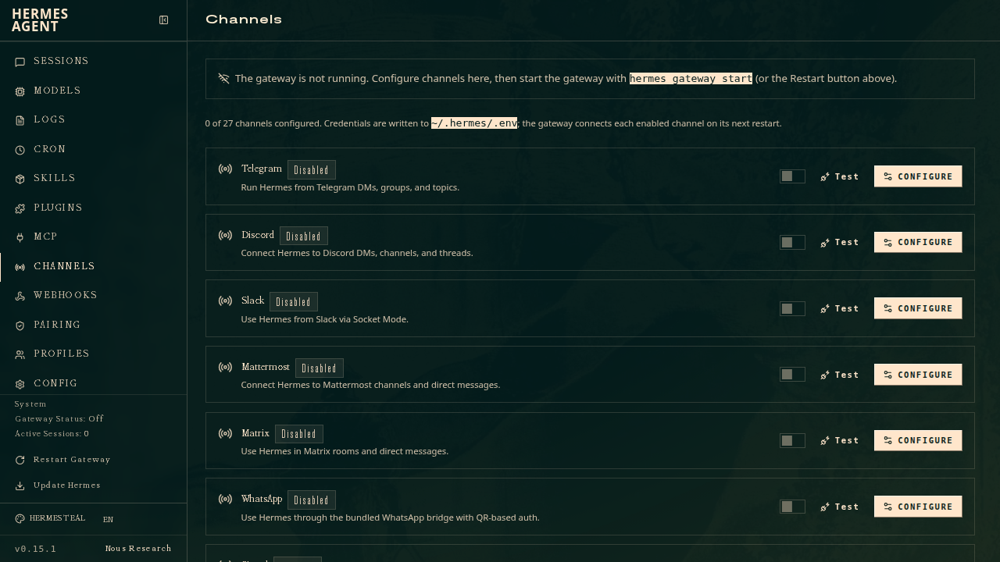
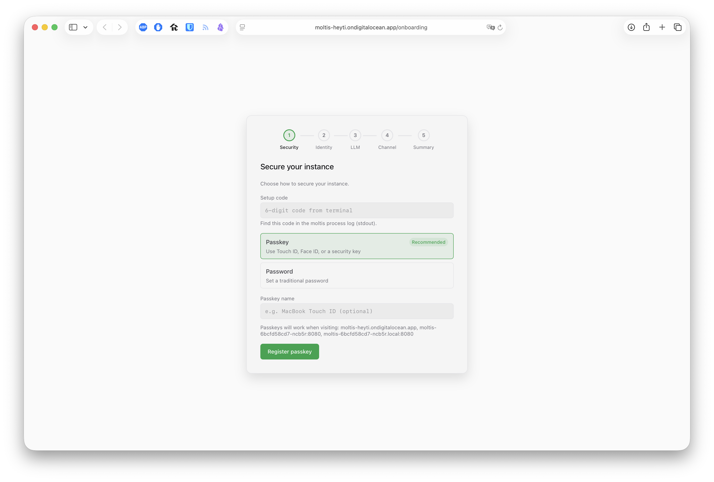
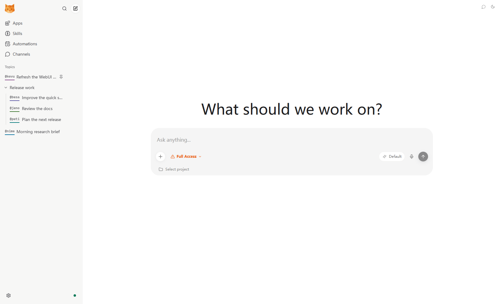
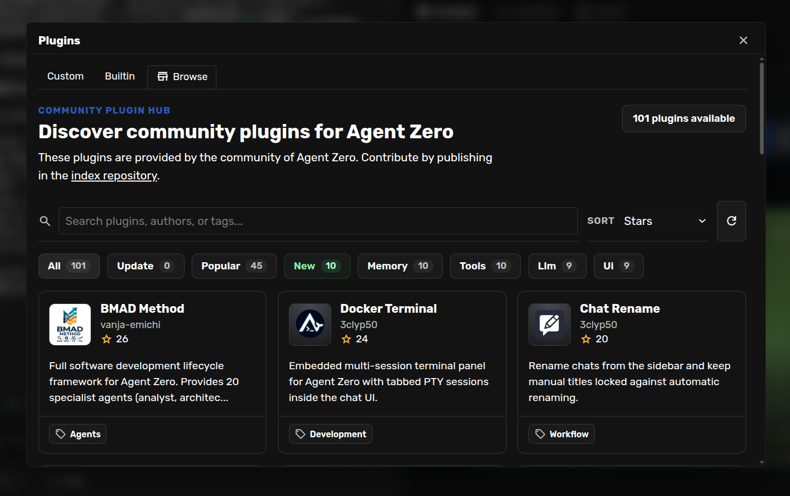
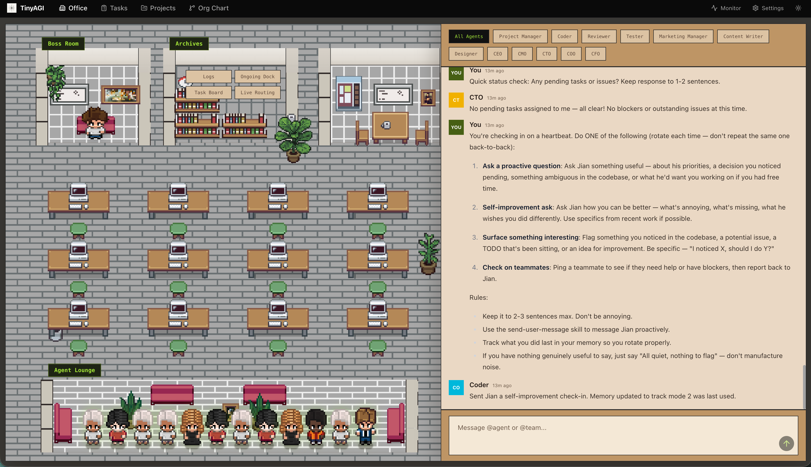
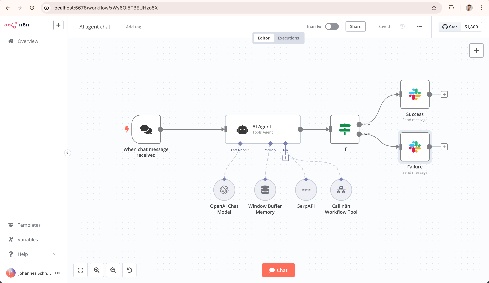
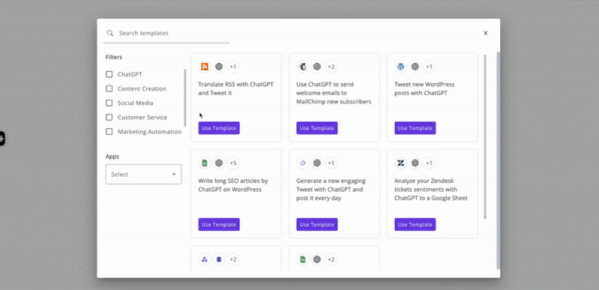
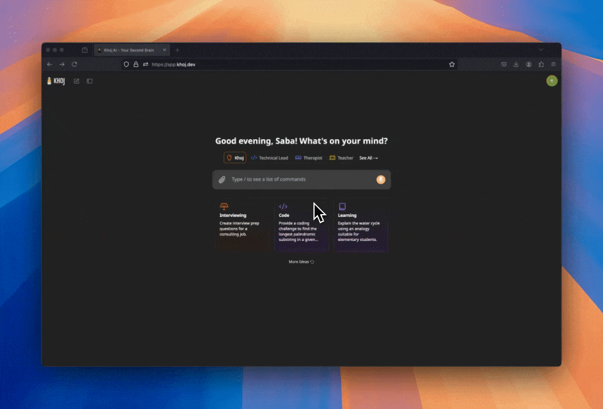

# Personal agents through WhatsApp: a 20-option decision guide

**Research snapshot: 2026-10-14.** Audience: one person using a personal WhatsApp number to check email and operate a development VPS. This environment is Debian GNU/Linux 13; that confirms this runtime environment, not the suitability of any agent. No agent was installed, paired, or given mailbox access during this review.

**Start with Hermes for broad personal-assistant fit; compare NanoClaw if containment matters more.** Moltis is a useful read-only-email challenger, with an important WhatsApp default to change. OpenClaw has broad ecosystem coverage; nanobot is a smaller alternative. None is established here as reliably safe with unrestricted email and VPS privileges. Twenty names are reviewed below; they are not twenty equally suitable recommendations.

## The decision in two minutes

| Trial priority | Candidate | Why it earns a look | What would make me reject it |
| --- | --- | --- | --- |
| 1 | **Hermes Agent** | Personal WhatsApp, tools, persistent context and useful first-person workflow reports. | Expecting its default command approvals to be a hard sandbox. [WhatsApp](https://hermes-agent.nousresearch.com/docs/user-guide/messaging/whatsapp), [security](https://hermes-agent.nousresearch.com/docs/user-guide/security). |
| 2 | **NanoClaw** | Container boundary and credential gateway; WhatsApp channel installation is documented. | Treating default networking and resource limits as locked down: they are not. [Project](https://github.com/nanocoai/nanoclaw), [security model](https://github.com/nanocoai/nanoclaw/blob/main/docs/SECURITY.md). |
| 3 | **Moltis** | Personal self-chat, documented sandboxing and explicit read-only Gmail/Himalaya connectors. | Pairing a personal account without changing its documented open DM/group policies. [WhatsApp](https://docs.moltis.org/whatsapp.html), [email](https://docs.moltis.org/email-connectors.html). |
| 4 | **OpenClaw** | Extensive channel/tool ecosystem and hardening documentation. | Installing arbitrary skills or assuming gateway authentication protects against malicious email. [WhatsApp](https://docs.openclaw.ai/channels/whatsapp), [security](https://docs.openclaw.ai/gateway/security). |
| 5 | **HKUDS nanobot** | Self-hosted Python agent with WebUI and an optional personal-WhatsApp plugin. | Following an old Baileys bridge tutorial, or mistaking filesystem restrictions for network containment. [Current channel guide](https://github.com/HKUDS/nanobot/blob/main/docs/chat-apps.md), [security](https://github.com/HKUDS/nanobot/blob/main/SECURITY.md). |

This order is editorial trial priority for your use, not a measured intelligence ranking. The numerical repository-health leaderboard appears below, with its formula. Capability descriptions refer to current docs, not a tag-tested deployment. It cannot choose a safe agent by itself. If isolation is the overriding priority, move NanoClaw ahead of Hermes; if read-only email is the first useful task, investigate Moltis first. If you want repeatable fixed automation rather than an open-ended assistant, inspect n8n or Activepieces—but their native WhatsApp integrations are Business integrations.

## What people actually do with these

| Everyday job | Evidence found | What the evidence does not establish |
| --- | --- | --- |
| **Condense busy group chats** | A construction-site worker reports OpenWA plus Hermes summarizing 11 WhatsApp groups, including crane and staffing updates. They also report scheduled follow-ups. [Original account](https://www.reddit.com/r/hermesagent/comments/1uhyift/i_turned_hermes_agent_into_my_construction_site/). | A few days of self-reported use, a custom OpenWA integration, and no measured omission rate. Not proof of native Hermes bridge reliability. |
| **Turn travel confirmations into an itinerary** | Users describe forwarding bookings, consolidating plans and catching a wrong train date. [First-person discussion](https://www.reddit.com/r/hermesagent/comments/1w2ig8h/real_use_cases/). | No controlled comparison against manual work; success depends on checking the source documents. |
| **Homelab checks and log triage** | The same discussion describes monitoring and investigating logs; other reports cover link archiving and food-photo logging. [Discussion](https://www.reddit.com/r/hermesagent/comments/1w2ig8h/real_use_cases/). | No uptime or accuracy measurements. Some participants explicitly spend more time tweaking than benefiting. |
| **Bounded inbox briefings** | Moltis documents read-only email datasets and bounded search/retrieval; this is an inspectable implementation route for a digest. [Connector docs](https://docs.moltis.org/email-connectors.html). | Documentation is capability evidence, not an independent report of saved time. |
| **A caution about “set and forget”** | An OpenClaw user reports an email watcher that multiplied into 13,994 cron jobs. [Incident account](https://www.reddit.com/r/openclaw/comments/1tea1pf/tifu_by_giving_openclaw_my_email/). | Unverified anecdote, not a prevalence estimate. It does identify a concrete failure mode: recurring work without deduplication or limits. |

The productive pattern is **one recurring task with a bounded input and an observable result**. A message digest or read-only service check fits that pattern. “Run my life” has no clear success test. This is an inference from the evidence, not a claim that all agents fail at broader work.

A research preprint provides useful pushback against benchmark hype: its 100-prompt comparison reports full completion of **31% for OpenClaw and 25% for NanoBot**, with no statistically established advantage. Its separate 23-prompt execution layer has provenance and scoring differences; the authors warn against conflating cheaper joint failures with capability. These April–June 2026 records do not rank today's releases or establish long-term WhatsApp reliability. [Paper, v1, 2026-08-28](https://arxiv.org/html/2608.27886v1).

## All 20 options: fit and safety

**Version boundary:** capabilities and defaults below describe current documentation/default branches. Availability in the listed release tags was not verified. In particular, NanoClaw v2 safeguards and nanobot's neonize migration must not be assumed present in their latest tagged releases; check the chosen release before a trial.

**Transport key:** **Personal** = documented unofficial linked-device/Web route; **Conditional** = build/plugin/custom integration required; **Business** = native route is Business API, not pairing your existing account; **Unknown** = current personal route not verified. Personal transport does not mean Meta-supported automation.

### Direct candidates and experimental alternatives

| # | Product and canonical source | Personal WhatsApp route | Email / VPS usefulness | Safety and operating caveat |
| --- | --- | --- | --- | --- |
| 1 | [Hermes Agent](https://github.com/NousResearch/hermes-agent) | Personal: Baileys, self-chat supported. | General terminal/SSH tools and extendable email tooling. | Default `smart` approvals assess selected command risks; shell access still has the execution user's privileges. Use an isolated backend for host separation. [Security](https://hermes-agent.nousresearch.com/docs/user-guide/security). |
| 2 | [NanoClaw](https://github.com/nanocoai/nanoclaw) | Personal via channel skill/adapter. | Tools and scheduled tasks; Gmail support advertised, setup still required. | Non-root containers and credential gateway; **egress lockdown off, CPU/memory caps unset by default**. Credentials being hidden does not prevent misuse of permitted API actions. [Model](https://github.com/nanocoai/nanoclaw/blob/main/docs/SECURITY.md). |
| 3 | [Moltis](https://github.com/moltis-org/moltis) | Personal: Linked Devices/self-chat. | Read-only Gmail/Himalaya connectors; command execution and remote tools. | Documented container/network controls and approvals; **WhatsApp DM/group policies default open**. For self-chat, disable other DMs and groups before pairing. [Channel](https://docs.moltis.org/whatsapp.html), [security](https://docs.moltis.org/security.html). |
| 4 | [OpenClaw](https://github.com/openclaw/openclaw) | Personal: Baileys/self-chat. | Broad tool/skill ecosystem for mailbox and host tasks. | Sandbox and tool policy require deliberate configuration; skills execute trusted code. Recent patch activity is evidence of maintenance, not absence of vulnerabilities. [Hardening](https://docs.openclaw.ai/gateway/security). |
| 5 | [nanobot](https://github.com/HKUDS/nanobot) | Conditional: current neonize plugin; QR pairing. | Tools, scheduling, memory and email/channel extensions. | Old Node/Baileys bridge removed; old session credentials cannot be reused. Filesystem sandboxing does not restrict networking. [Channels](https://github.com/HKUDS/nanobot/blob/main/docs/chat-apps.md), [security](https://github.com/HKUDS/nanobot/blob/main/SECURITY.md). |
| 6 | [ZeroClaw](https://github.com/zeroclaw-labs/zeroclaw) | Conditional: `whatsapp-web` build feature, persistent session database. | General shell/tool agent; email fit depends on selected tools. | Current canonical docs verify personal and Cloud API as separate backends. Risk/runtime profiles govern privileges; verify the actual build, not a mirror's feature list. [WhatsApp](https://github.com/zeroclaw-labs/zeroclaw/blob/master/docs/book/src/channels/whatsapp.md), [security](https://github.com/zeroclaw-labs/zeroclaw/blob/master/docs/book/src/security/overview.md). |
| 7 | [PicoClaw](https://github.com/sipeed/picoclaw) | Conditional: native whatsmeow build feature or external bridge. | Lightweight general tool agent, attractive for constrained hosts. | Small binary and language choice do not prove safety. Its default-branch code date is older than its latest push date; inspect the installed build. [Channel guide](https://github.com/sipeed/picoclaw/blob/main/docs/guides/chat-apps.md). |
| 8 | [Agent Zero](https://github.com/agent0ai/agent-zero) | Personal QR pairing described in releases. | Broad Linux/tool automation; current Email and WhatsApp plugin settings documented. | Releases record WhatsApp path-traversal and IMAP whitelist fixes. A container running the agent is not automatically separation from everything mounted into it. [Release notes](https://github.com/agent0ai/agent-zero/releases). |
| 9 | [NullClaw](https://github.com/nullclaw/nullclaw) | Conditional: separate WhatsApp Web example/plugin bridge. | General agent with tools and scheduling; mail setup requires integration work. | Do not confuse the core Business webhook adapter with the personal bridge. Sandbox backends are documented; enforcement on this Debian host was not tested. [Personal example](https://github.com/nullclaw/nullclaw/blob/main/examples/whatsapp-web/README.md). |
| 10 | [OpenFang](https://github.com/RightNow-AI/openfang) | Personal QR gateway, separate Node process. | Scheduled autonomous tasks and tools. | README says pre-1.0 and warns about breaking changes. Default-branch code is from May in this snapshot; claims of constant shipping need that context. Its security charts are vendor claims. |
| 11 | [TinyAGI, formerly TinyClaw](https://github.com/TinyAGI/tinyagi) | Personal: `whatsapp-web.js`. | Routes tasks to CLI agents; documented queue/retry handling. | Sender pairing exists, but separate workspaces/history are not an OS sandbox. Default-branch code is from March; attractive UI does not resolve upkeep risk. |
| 12 | [whatsapp-leo](https://github.com/shansin/whatsapp-leo) | Personal-oriented WhatsApp assistant; README recommends a dedicated number. | Gmail search/read/drafts, calendar, web tools and local-model support. | Write confirmation exists but defaults **false**; browser no-sandbox defaults true. No release and no license detected in the snapshot. Prototype to inspect, not a default recommendation. |
| 13 | [NanoClaw-Lite](https://github.com/codedojokapa/nanoclaw-lite) | Personal WhatsApp lineage and channels. | In-process agent customization on a VPS. | Explicitly removes the container runner and relies on application-level separation. March activity, four stars, no release. Do not inherit upstream NanoClaw safety claims. |

### Useful comparisons that do not currently satisfy the full brief

| # | Product and canonical source | WhatsApp / hosting gap | When it could still be useful |
| --- | --- | --- | --- |
| 14 | [IronClaw — NEAR AI](https://github.com/nearai/ironclaw) | Canonical feature matrix explicitly marks **WhatsApp unsupported**. Other projects named IronClaw are not this product. [Matrix](https://github.com/nearai/ironclaw/blob/main/FEATURE_PARITY.md). | Investigate its documented WASM capability boundaries if you can change messaging channel. Actual safety remains untested. |
| 15 | [QwenPaw, formerly CoPaw](https://github.com/agentscope-ai/QwenPaw) | Current README lists other channels; personal WhatsApp was **not verified**. | Personal workstation, scheduling and tool guards; relevant if another channel is acceptable. “WeChat” is not WhatsApp. |
| 16 | [CowAgent, formerly chatgpt-on-wechat](https://github.com/zhayujie/CowAgent) | Current listed channels do not establish personal WhatsApp. | Tools, scheduler and knowledge/memory workflows. Long repository history includes the earlier product; it is not years of evidence for today's agent behavior. |
| 17 | [Letta Code](https://github.com/letta-ai/letta-code) | Current harness lists Telegram/Slack/Discord/custom channels, not a verified personal WhatsApp adapter. Remote-computer/account features involve Letta Cloud. | Persistent agents and permission modes if you accept integration work and verify which state remains hosted. The old `letta-ai/letta` repo now points here; do not rank only its older metadata. |
| 18 | [Khoj](https://github.com/khoj-ai/khoj) | Official WhatsApp instructions connect to **Khoj Cloud**, not evidence of pairing your own self-hosted instance. [WhatsApp docs](https://docs.khoj.dev/clients/whatsapp/). | Personal document search, research and scheduled notifications. Not established here as a WhatsApp-to-VPS operator. |
| 19 | [n8n](https://github.com/n8n-io/n8n) | Native WhatsApp node is **Business Cloud**; personal-account use needs a separate unofficial bridge. [Node docs](https://docs.n8n.io/integrations/builtin/app-nodes/n8n-nodes-base.whatsapp/). | Better candidate for a fixed, auditable email workflow with explicit review steps than a free-form “do anything” agent. It remains privileged software that needs patching. |
| 20 | [Activepieces](https://github.com/activepieces/activepieces) | Native WhatsApp piece is **Business**, not a personal linked-device adapter. [Integration](https://www.activepieces.com/pieces/whatsapp). | Visual bounded workflows and app connections; an extra personal bridge adds another credential store and failure point. |

“Unknown” means not established by the opened current sources, not proof that a community adapter cannot exist. The seven comparison entries remain in the decision guide to expose exclusions rather than pad the shortlist with incompatible “winners.”

## Safety: evaluate boundaries, not adjectives

**Personal WhatsApp is a separate reliability risk.** Hermes explicitly describes its personal bridge as unofficial and warns about account restrictions and protocol changes. No ban probability was established. A sender allowlist restricts who triggers a turn; it does not stop malicious content inside an allowed email or webpage. Linked-device session files are credentials. Moltis also states that the linked device sees incoming personal messages even when self-chat policies prevent replies. Self-hosting the orchestrator also does not keep prompts local if you select a hosted model. [Transport and risk disclosure](https://hermes-agent.nousresearch.com/docs/user-guide/messaging/whatsapp).

**Email plus a shell is the consequential combination here.** Varonis Threat Labs tested an OpenClaw inbox with synthetic company data and two model/configuration profiles. In one scenario it forwarded staged infrastructure credentials to an impersonator despite explicit safety instructions. This was a security vendor's controlled experiment, not a claim about every current deployment. It supports removing privileges, not adding stronger wording to a prompt. [Primary report, updated 2026-06-09](https://www.varonis.com/blog/openclaw-phishing).

**Patch records need version context.** OpenClaw's host-exec environment-filtering advisory identifies affected versions through 2026.6.1 and a fix in 2026.6.6. Hermes' reviewed injection advisory lists versions below 0.18.0 and a patch at 0.18.0. These are historical fixed issues, not proof that current tags are vulnerable or fully audited. [OpenClaw advisory](https://github.com/openclaw/openclaw/security/advisories/GHSA-hjr6-g723-hmfm), [Hermes advisory](https://github.com/advisories/GHSA-mv8x-fg99-32mf).

For this use, I would evaluate a **read-only mailbox connector plus a separate restricted VPS executor** before allowing mail-driven general shell access. Keep mail content as data; restrict outbound destinations and credentials; expose specific status/log commands before arbitrary execution. Require a real tool boundary for sends, deletion and host changes. A natural-language “ask first” instruction is not that boundary. Moltis' read-only connector cache stores selected mail data in plaintext, so storage protection remains necessary. [Connector storage](https://docs.moltis.org/email-connectors.html). These are proposed deployment choices, not changes made on this VPS.

## Forks, renamed projects and hype filters

| Finding | Decision consequence |
| --- | --- |
| NanoClaw moved from `qwibitai` to `nanocoai`; CoPaw now redirects to QwenPaw; TinyClaw now redirects to TinyAGI. | Use canonical ownership and the current release, not a similarly named search result. |
| NanoClaw-Lite describes itself as container-free; the upstream name remains throughout parts of its README. | Review what was removed. Smaller is not automatically safer. GitHub's `fork` flag alone does not identify every derivative. |
| ZeroClaw and IronClaw have lookalikes/mirrors. | Check origin links and package publishers. Do not transfer a mirror's WhatsApp or security claims to canonical upstream. |
| “Self-improving” means the agent may rewrite memory, skills or prompts. | Treat those changes as mutable configuration/code with review and rollback, not measured gains in intelligence. |
| No published advisories, low issue counts or many stars. | None establishes an audit, low failure rate or safe defaults. New and little-used software can have few reported problems. |

## Freshness and repository health

The next table is a **repository-signal leaderboard**, not the trial-priority order. It applies the project's existing point scale to three applicable, machine-observed dimensions: **stars + push recency + repository age**, each weight **1**. Scale: red = −1, yellow = 0, green = 1, double-green = 2; maximum **6**. Thresholds and raw grades are preserved in the snapshot. Missing values stay unknown; none of these three fields was missing in this run.

These are **partial** health totals: source idiomaticity, maintainer responsiveness, deployment reliability and security effectiveness were not measured. License and README evidence are reported separately rather than silently assigned zero or used as safety proxies. Gleam compatibility does not apply. Weights are equal because this is the existing repository-signal sum, not invented precision about “smartness.” Ties have equal rank. Selection still requires the personal-WhatsApp and safety checks above.

**Read both activity dates.** `pushed_at` can advance without a new default-branch commit. The table includes the actual default-branch HEAD commit date, obtained separately through GitHub's commit API; neither date proves stable-release delivery. “Open” is GitHub's `open_issues_count`, which includes pull requests—not a clean count of bugs.

| Rank | Repository | Stars | Push / HEAD commit | Open incl. PRs | Star + recency + age | Partial total / 6 |
| --- | --- | ---: | --- | ---: | --- | ---: |
| 1 | [Activepieces](https://github.com/activepieces/activepieces) | 25,053 | 2026-10-14 / 2026-10-14 | 739 | 2 + 2 + 2 | 6 |
| 1 | [CowAgent](https://github.com/zhayujie/CowAgent) | 47,403 | 2026-10-14 / 2026-10-14 | 80 | 2 + 2 + 2 | 6 |
| 1 | [n8n](https://github.com/n8n-io/n8n) | 207,380 | 2026-10-14 / 2026-10-14 | 1,194 | 2 + 2 + 2 | 6 |
| 4 | [Agent Zero](https://github.com/agent0ai/agent-zero) | 19,472 | 2026-10-14 / 2026-10-13 | 134 | 2 + 2 + 1 | 5 |
| 4 | [Hermes](https://github.com/NousResearch/hermes-agent) | 253,752 | 2026-10-14 / 2026-10-14 | 48,793 | 2 + 2 + 1 | 5 |
| 4 | [Khoj](https://github.com/khoj-ai/khoj) | 37,685 | 2026-08-02 / 2026-08-02 | 169 | 2 + 1 + 2 | 5 |
| 7 | [IronClaw](https://github.com/nearai/ironclaw) | 12,656 | 2026-10-13 / 2026-09-10 | 1,550 | 2 + 2 + 0 | 4 |
| 7 | [Letta Code](https://github.com/letta-ai/letta-code) | 3,608 | 2026-10-14 / 2026-10-14 | 521 | 2 + 2 + 0 | 4 |
| 7 | [Moltis](https://github.com/moltis-org/moltis) | 2,888 | 2026-09-22 / 2026-09-22 | 114 | 2 + 2 + 0 | 4 |
| 7 | [nanobot](https://github.com/HKUDS/nanobot) | 49,034 | 2026-10-14 / 2026-10-14 | 864 | 2 + 2 + 0 | 4 |
| 7 | [NanoClaw](https://github.com/nanocoai/nanoclaw) | 30,946 | 2026-10-14 / 2026-10-14 | 1,048 | 2 + 2 + 0 | 4 |
| 7 | [NullClaw](https://github.com/nullclaw/nullclaw) | 8,125 | 2026-10-08 / 2026-10-05 | 76 | 2 + 2 + 0 | 4 |
| 7 | [OpenClaw](https://github.com/openclaw/openclaw) | 392,004 | 2026-10-14 / 2026-10-14 | 9,634 | 2 + 2 + 0 | 4 |
| 7 | [PicoClaw](https://github.com/sipeed/picoclaw) | 30,019 | 2026-10-09 / 2026-08-19 | 41 | 2 + 2 + 0 | 4 |
| 7 | [QwenPaw](https://github.com/agentscope-ai/QwenPaw) | 35,692 | 2026-10-14 / 2026-10-14 | 1,084 | 2 + 2 + 0 | 4 |
| 7 | [ZeroClaw](https://github.com/zeroclaw-labs/zeroclaw) | 32,979 | 2026-10-14 / 2026-10-14 | 962 | 2 + 2 + 0 | 4 |
| 17 | [OpenFang](https://github.com/RightNow-AI/openfang) | 18,217 | 2026-07-02 / 2026-05-12 | 127 | 2 + 1 + 0 | 3 |
| 18 | [TinyAGI](https://github.com/TinyAGI/tinyagi) | 3,621 | 2026-03-30 / 2026-03-30 | 72 | 2 + 0 + 0 | 2 |
| 19 | [whatsapp-leo](https://github.com/shansin/whatsapp-leo) | 0 | 2026-10-09 / 2026-10-09 | 1 | -1 + 2 + 0 | 1 |
| 20 | [NanoClaw-Lite](https://github.com/codedojokapa/nanoclaw-lite) | 4 | 2026-03-16 / 2026-03-16 | 0 | -1 + 0 + 0 | -1 |

The disparity is useful: CowAgent, n8n and Activepieces score strongly on repository signals while failing to establish your requested personal-WhatsApp route natively. NanoClaw-Lite scores poorly and also removes a relevant boundary. Popularity cannot substitute for fit; the same score can describe very different risks.

<details>
<summary>Release dates, licenses and review artifacts</summary>

| Product | API latest release | Published | API license |
| --- | --- | --- | --- |
| [Hermes](https://github.com/NousResearch/hermes-agent) | v0.22.0 | 2026-10-14 | MIT |
| [OpenClaw](https://github.com/openclaw/openclaw) | v2026.10.3 | 2026-10-13 | MIT |
| [NanoClaw](https://github.com/nanocoai/nanoclaw) | v2026.10.0 | 2026-10-09 | MIT |
| [nanobot](https://github.com/HKUDS/nanobot) | v0.3.5 | 2026-09-15 | MIT |
| [PicoClaw](https://github.com/sipeed/picoclaw) | v0.3.1 | 2026-07-03 | MIT |
| [ZeroClaw](https://github.com/zeroclaw-labs/zeroclaw) | v0.8.5 | 2026-09-05 | Apache-2.0 |
| [IronClaw](https://github.com/nearai/ironclaw) | ironclaw-v1.4.1 | 2026-09-29 | Apache-2.0 |
| [NullClaw](https://github.com/nullclaw/nullclaw) | v2026.5.29 | 2026-05-29 | MIT |
| [OpenFang](https://github.com/RightNow-AI/openfang) | v0.6.9 | 2026-05-12 | Apache-2.0 |
| [Moltis](https://github.com/moltis-org/moltis) | 20260913.02 | 2026-09-14 | MIT |
| [Agent Zero](https://github.com/agent0ai/agent-zero) | v2.14 | 2026-10-13 | NOASSERTION |
| [QwenPaw](https://github.com/agentscope-ai/QwenPaw) | v2.2.1 | 2026-09-11 | Apache-2.0 |
| [CowAgent](https://github.com/zhayujie/CowAgent) | 2.2.1 | 2026-10-14 | MIT |
| [whatsapp-leo](https://github.com/shansin/whatsapp-leo) | None published | — | none |
| [NanoClaw-Lite](https://github.com/codedojokapa/nanoclaw-lite) | None published | — | MIT |
| [TinyAGI](https://github.com/TinyAGI/tinyagi) | v0.0.20 | 2026-03-26 | MIT |
| [Khoj](https://github.com/khoj-ai/khoj) | 2.0.0-beta.28 | 2026-03-26 | AGPL-3.0 |
| [n8n](https://github.com/n8n-io/n8n) | n8n@2.43.5 | 2026-10-14 | NOASSERTION |
| [Activepieces](https://github.com/activepieces/activepieces) | 0.92.3 | 2026-10-12 | NOASSERTION |
| [Letta Code](https://github.com/letta-ai/letta-code) | v0.34.14 | 2026-10-14 | Apache-2.0 |

The API's `NOASSERTION` is not “unlicensed.” Agent Zero's [current license file](https://github.com/agent0ai/agent-zero/blob/main/LICENSE) says MIT. Activepieces has [MIT Expat outside specified enterprise directories](https://github.com/activepieces/activepieces/blob/main/LICENSE). n8n uses [Sustainable Use License plus enterprise exceptions](https://github.com/n8n-io/n8n/blob/master/LICENSE.md), not unrestricted open-source licensing. No license was verified for whatsapp-leo. These are distribution facts, not legal advice or security scores.

Tooling ran before drafting:

```sh
cd tools/repo-health-metrics
gleam run -- NousResearch/hermes-agent openclaw/openclaw nanocoai/nanoclaw HKUDS/nanobot sipeed/picoclaw zeroclaw-labs/zeroclaw nearai/ironclaw nullclaw/nullclaw RightNow-AI/openfang moltis-org/moltis agent0ai/agent-zero agentscope-ai/QwenPaw zhayujie/CowAgent shansin/whatsapp-leo codedojokapa/nanoclaw-lite TinyAGI/tinyagi letta-ai/letta khoj-ai/khoj n8n-io/n8n activepieces/activepieces --snapshot 2026-10-14 --json
gleam run -- letta-ai/letta-code --snapshot 2026-10-14 --json
```

Original outputs: `/tmp/personal-agents-repo-health-2026-10-14.json` and `/tmp/personal-agents-letta-current-2026-10-14.json`. Both raw runs plus GitHub HEAD/release/provenance observations are preserved in [research-snapshot-2026-10-14.json](assets/personal-agents/research-snapshot-2026-10-14.json). Twenty products correspond to 21 inspected repositories because Letta moved its active source. The old repository is retained as evidence, not counted as a second product.

Raw tool license grades are not a safety verdict; its push-recency grade is not a commit-date measurement. Rendered READMEs and linked docs were inspected for features, not source-code correctness. Full seven-dimension library totals would be misleading for these applications.

</details>

<details>
<summary>UI screenshots: public upstream examples, not tests on this VPS</summary>

Eight public upstream UI captures are embedded below. Retrieved **2026-10-14**, pinned to repository commits; original capture dates are **unknown**, so they are not proof of the current release UI. Khoj and Activepieces show the first frame of upstream GIFs. [Preview sources, transformations and SHA-256 hashes](assets/personal-agents/previews.json).

### Hermes: channel administration



Source: [NousResearch/hermes-agent](https://raw.githubusercontent.com/NousResearch/hermes-agent/e8c8e464715d11bfb7b3006edabff6b719a29b8b/website/static/img/dashboard/admin-channels.png); captured date unknown; retrieved 2026-10-14.


### Moltis: initial security setup



Source: [moltis-org/moltis](https://raw.githubusercontent.com/moltis-org/moltis/1f6d28ea750d6654d52d5899b8be67727ebf7a19/website/screenshots/1.png); captured date unknown; retrieved 2026-10-14.


### nanobot: WebUI chat



Source: [HKUDS/nanobot](https://raw.githubusercontent.com/HKUDS/nanobot/3a28b9e6ce5e514d4dee9d964056d876a69a6cdc/images/nanobot_webui.png); captured date unknown; retrieved 2026-10-14.


### Agent Zero: plugin browser



Source: [agent0ai/agent-zero](https://raw.githubusercontent.com/agent0ai/agent-zero/ff2a5b9c9c4e490ba38dd7c313e779510bb2071a/docs/res/usage/plugins/plugin-hub-browse.png); captured date unknown; retrieved 2026-10-14.


### TinyAGI: TinyOffice portal



Source: [TinyAGI/tinyagi](https://raw.githubusercontent.com/TinyAGI/tinyagi/2db3a03a891b302c460f624d6c5a0523b8aa3528/docs/images/tinyoffice.png); captured date unknown; retrieved 2026-10-14.


### n8n: workflow editor



Source: [n8n-io/n8n](https://raw.githubusercontent.com/n8n-io/n8n/50c4ced2241430e13fa7042e976ed33f07bf5009/assets/n8n-screenshot-readme.png); captured date unknown; retrieved 2026-10-14.


### Activepieces: template browser



Source: [activepieces/activepieces](https://raw.githubusercontent.com/activepieces/activepieces/8d8a1b466efacce86e13423e04ed09083d6c37e1/docs/resources/templates.gif); captured date unknown; retrieved 2026-10-14.


### Khoj: web chat



Source: [khoj-ai/khoj](https://raw.githubusercontent.com/khoj-ai/khoj/ae229ca894c0b80ad84664afcfdde523b5e87057/documentation/assets/img/quadratic_equation_khoj_web.gif); captured date unknown; retrieved 2026-10-14.


OpenClaw's [Control UI](https://docs.openclaw.ai/web/control-ui), QwenPaw's console and Letta's desktop/web interfaces are documented, but this review did not verify reusable screenshots for every interface among the 20 products. NanoClaw and several small runtimes primarily expose messaging/CLI surfaces. Screenshot coverage is partial; no mock interface is substituted for missing evidence.

</details>

<details>
<summary>Research trail, credibility and remaining gaps</summary>

Search and source verification date: **2026-10-14**. Discovery covered more than the supplied Hermes example. Queries included `Hermes agent WhatsApp self hosted NousResearch github`, `self hosted personal AI assistant WhatsApp OpenClaw alternatives nanobot NanoClaw 2026`, `OpenFang NullClaw github personal assistant WhatsApp`, `Moltis personal assistant github WhatsApp security`, `CoPaw github WhatsApp email personal assistant`, `NanoClaw Lite github`, `OpenClaw productive everyday use email WhatsApp security vulnerabilities`, `OpenClaw everyday email digest actual use productivity cost failed`, and searches for Hermes/NanoClaw advisories, unofficial account restrictions and firsthand daily-use reports. Follow-ups opened canonical repositories, current channel/security documentation, original user reports, release notes and advisory records.

Comparison directories were discovery aids, not authoritative capability evidence. Primary project docs establish advertised capabilities and stated defaults; they do not establish runtime enforcement. Community posts are anecdotal and can be promotional. Hermes' [user-story directory](https://hermes-agent.nousresearch.com/docs/user-stories) is vendor-curated and has no adoption denominator. The Varonis test is independent of the agent vendor but authored by a security seller. The cited preprint has version, environment and provenance limitations. None is a substitute for a sustained trial with your mailbox and tasks.

The WhatsApp FAQ opened without readable content, so no blanket Meta-policy interpretation or numerical ban risk is asserted; Hermes' own explicit unofficial-bridge warning supports the narrower transport caveat. A purported email-cost blog could not be opened and was not used to substantiate a cost claim. Model/API charges, actual accuracy, token use, reconnect survival, skill quality, update rollback, Debian sandbox enforcement, vulnerabilities across every dependency and long-term reliability were not tested. Generic skill/MCP support does not verify compatibility with your unspecified email provider.

Verification checked 20 catalog entries, all 20 health totals and tied ranks, eight preview hashes, image decoding, local links and whitespace. Of 59 cited URLs, 55 returned HTTP 200 in a direct check; Reddit blocked that client and Varonis timed out, but all four were readable in the research browser.

One bounded worker researched independent candidate/security evidence; the main reviewer checked canonical links and synthesized the guide. Discussion binding failed because the worker interface supplied a canonical name rather than an accepted UUID; research remained in the main task and no additional task was started.

</details>

## What I would try first

**Hermes in a restricted execution environment, with one read-only task.** Send a WhatsApp self-message asking for an inbox digest or a bounded VPS status check. Compare the result against its source, then repeat for a week before expanding privileges. NanoClaw is the containment comparison; Moltis is the read-only-mail comparison after correcting its personal-account policies.

Measure useful completed tasks, corrections needed, maintenance minutes and actual provider cost. Keep those separate: a cheap wrong answer and an hour fixing a bridge are not productivity. This is a proposed evaluation, not an installation or a claim that any candidate has passed it.
