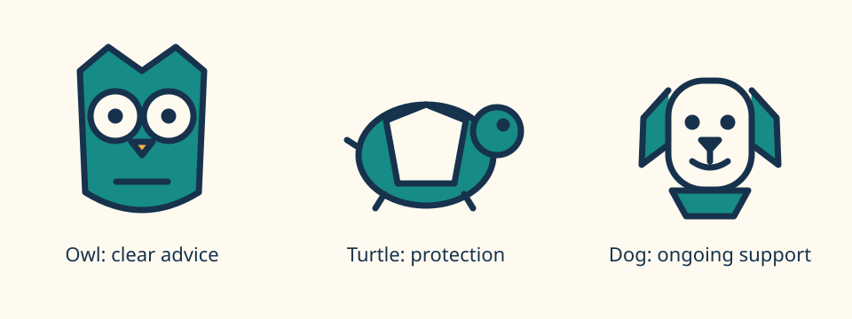

# AI design tools for a consistent insurance-broker mascot

> [!NOTE]
> **Status:** DRAFT · **Authoring:** AI-assisted; human brand approval pending.

**Snapshot: 2026-10-10.** Ranking goal: explore a credible broker mascot, preserve its identity across campaigns, and retain an editable production asset. This is a source-based evaluation, not a paid-model bake-off. Embedded artwork is original SVG authored for this article; it is not evidence of any vendor's image quality.

## Recommendation

Use image models to explore directions, then approve and save a vector master. Use Claude Code or Codex to edit that master under a written character specification. Reuse the saved geometry for the website, print, and animation. Reference-guided image generation can produce convincing scenes; it does not make the character's geometry deterministic.

This follows the source-first approach in [diagramming](diagramming.md) and the separation of rendering targets in [charts](charts.md). [Typography](typography.md) covers the wordmark and surrounding layout. The [shared review rubric](../practices/formalization.md) informs evaluation, but stars do not compare proprietary image services with coding tools. The domain criteria below take precedence.

## Embedded concept preview



[Open the full-size SVG and inspect its source](assets/broker-mascot.svg). No installation or service account is needed. These are exploration directions, not an approved brand or a claim of trademark clearance.

| Concept | Brand proposition | Risk to test with customers |
| --- | --- | --- |
| Owl adviser | Explains complicated policies clearly | Can look patronising or resemble education brands |
| Turtle protector | Long-term protection and calm | Can imply slow claims handling |
| Dog companion | Friendly support through renewals and claims | Can look like pet insurance only |

For a broker, the character should communicate advice and choice, not promise that every risk is covered. Test the owl first when clarity is the main proposition. Keep facial expression calm and avoid emergency-services symbols. Treat palette and species as proposals until a human approves them.

## What “reproducible” means

| Requirement | Reliable mechanism | Remaining limit |
| --- | --- | --- |
| Exact source asset | Commit the approved SVG bytes and their checksum | Browser text rasterisation can differ; outline final wordmark lettering |
| Consistent web character | Reuse named SVG groups and fixed palette | New poses still need review |
| Similar character in new scenes | Reference sheet plus constrained image edits | Eye shape, proportions, accessories can drift |
| Replay an image-generation request | Save model ID, prompt, input files, settings, and response | Repeating the request does not guarantee identical pixels |
| Repeat an animation | Save timeline, rig, geometry, and export settings | Generative video can change anatomy between frames |

An embedded PNG inside an SVG wrapper is still a bitmap. Automatic tracing produces paths but does not reconstruct intentional joints, editable expressions, or a reusable character rig.

## Production route: SVG first

1. Approve one species, silhouette, palette, and expression sheet. Include front, side, and three-quarter views.
2. Save a master with named groups: body, eyes, beak or muzzle, arms, and accessories. Keep colour tokens and proportions explicit.
3. Ask a coding agent to modify only named groups. Review the visual diff and commit approved changes.
4. Export SVG for web and vector print workflows; rasterise a copy for social platforms. Keep the vector original.
5. Animate transforms of the existing groups before adding a new renderer. Canvas is useful for many moving instances; WebGL earns its cost for 3D or shaders.

The preview uses SVG primitives and fixed geometry. Its three groups are `owl`, `turtle`, and `dog`. SVG scales without regenerating the character. It is not yet a multi-pose rig: an artist must approve joints and additional views before animation.

### Reusable exploration brief

```text
Create three distinct branding directions for an independent insurance broker.
The character communicates clear advice, calm protection, and continuing support.
Use a flat vector-like style with navy #17324d, teal #168b87, cream #fffaf0.
Show one front view, one side view, and three expressions per direction.
No policy promises, lettering, gradients, or existing brand references.
After approval, preserve species, silhouette, eye spacing, and accessory design.
Change only the requested pose or expression. Use the approved sheet as reference.
```

“Vector-like” describes appearance; it does not request genuine paths from an image model. For production, give a coding agent the actual SVG and request a source edit. Do not ask it to recreate the mascot from the prompt on each run.

## Evaluation protocol

Use one approved reference sheet across every service. Request a neutral front view, a side view, a waving pose, a concerned expression, and a small monochrome icon. Repeat each request three times and retain every output, including failures. This protocol is proposed; it has not been run against paid services here.

Score each output 0–2 on silhouette, face, palette, accessory identity, and required pose. Zero means wrong, one means repairable, two means approved. A wrong species, extra limb, or changed signature accessory is a rejection regardless of total. Record time, retries, credits consumed, model ID, and whether output can be edited as actual paths. Review at 24 px, at normal web size, and in monochrome.

Treat vendor consistency claims as documented capabilities, not measured reliability. The winner for concept imagery can differ from the winner for exact production assets.

## Current model baseline

OpenAI's current API guide recommends `gpt-image-2.5-sunburst` for precise editing and `gpt-image-2.5-flare` for faster everyday generation. The guide also warns that recurring characters and brand elements can lose consistency. Use saved references, not a prompt alone. These are raster workflows, not native SVG generation. [Official OpenAI image-generation documentation](https://developers.openai.com/api/docs/guides/image-generation).

Claude Code is a coding tool, not an image-model name. Anthropic announced Opus 5.5 on 2026-09-22; record the resolved model rather than a moving `opus` alias. Claude Design's April launch described brand systems, iterative editing, and HTML/PDF/PPTX/Canva exports, with handoff to Claude Code. That launch's Opus 4.7 description is historical, not the current Code model baseline. [Opus 5.5 announcement](https://www.anthropic.com/claude-opus-5-5), [Code model configuration](https://code.claude.com/docs/en/model-config), [Claude Design launch](https://www.anthropic.com/news/claude-design-anthropic-labs).

The named-provider comparison and its research trail are expanded in subsequent sections. Prices and commercial-use terms need checking for the exact plan before purchase; account access was not tested.
