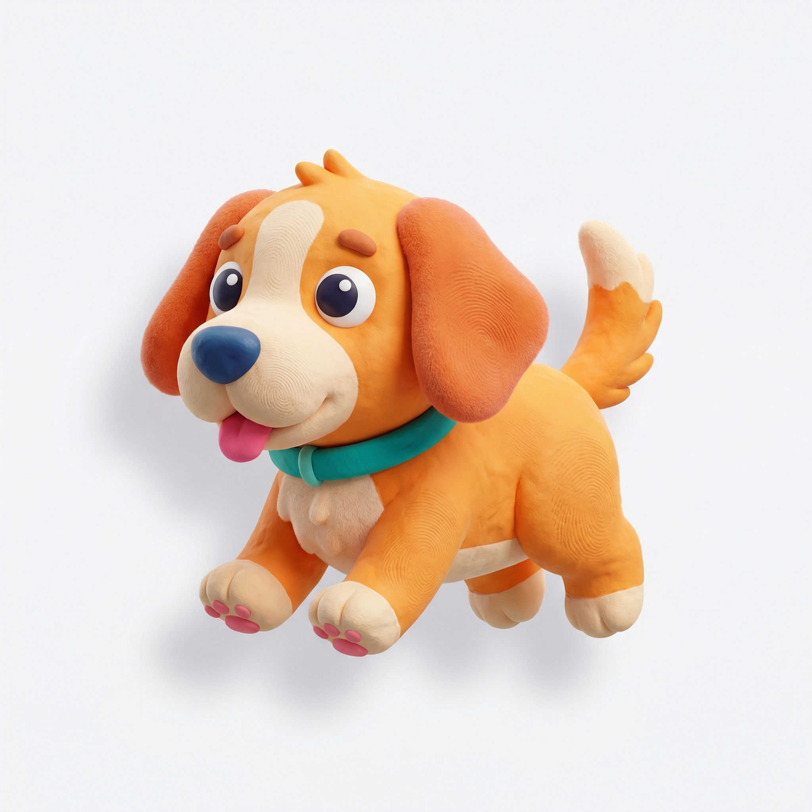
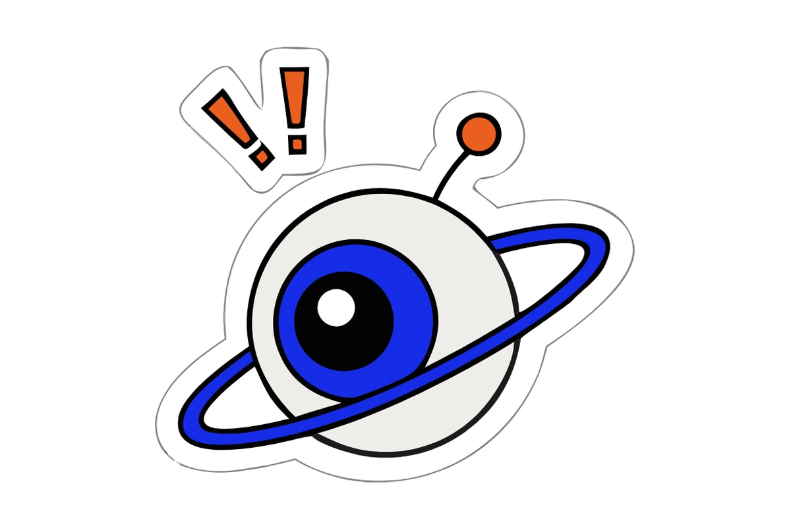
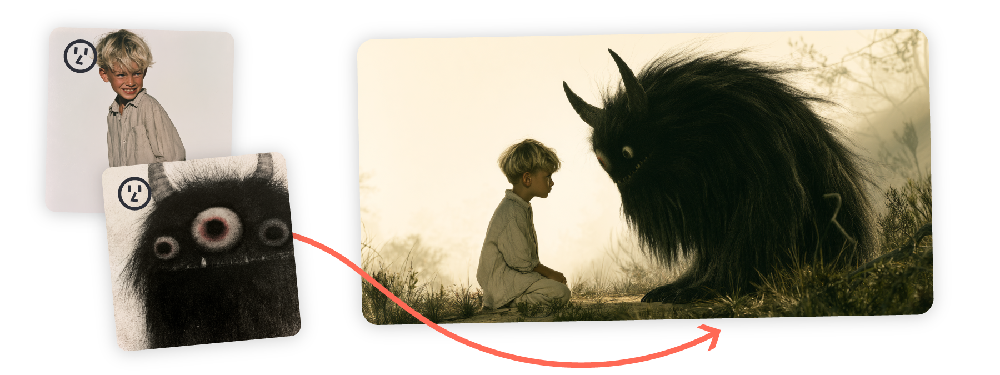
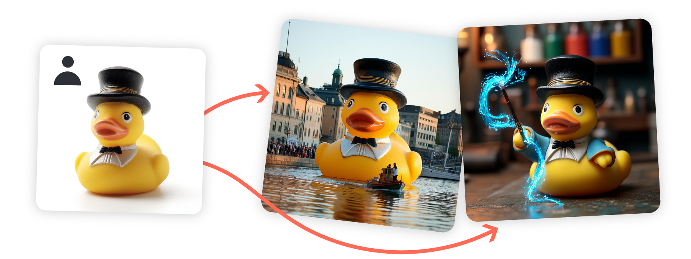
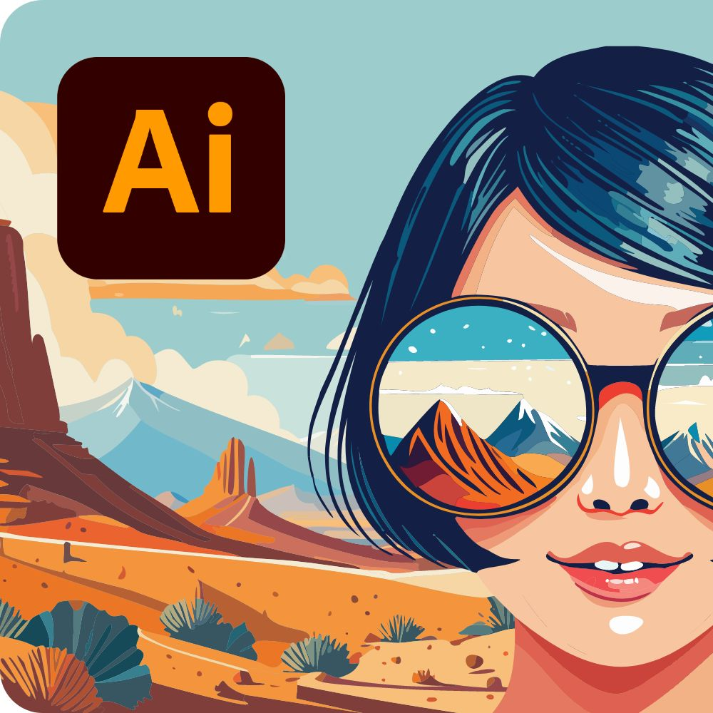

# Brand concept / mascot development

**Reading time: about 4 minutes, excluding extra previews.** Research checked 2026-10-11. Public examples, not our own model tests.

This is a one-off concept decision: try different tools and play with ideas before choosing a direction. You do not need to choose a technical stack.

1. Write a short brief: brand personality, audience, and what the mascot should communicate.
2. Try the same brief in several image tools. Save promising designs and note the tool, model, and prompt.
3. Pick a few directions by visual appeal. Use reference images to explore expressions, poses, and scenes.
4. Choose a concept after looking at the variations. Decide how to turn it into website assets later.

No grading or automatic winner. The examples below help you find looks worth trying. The optional [website-asset workflow](ai-mascot-workflows.md) covers later image, SVG, and 3D routes.

## The Google dog: where it comes from

**Creator/source:** Google’s [official image-generation guide](https://ai.google.dev/gemini-api/docs/image-generation). The page explicitly labels this example **“Generated by Nano Banana Pro”**. That model’s API name is `gemini-3-pro-image`.

**Published prompt:**

> An icon representing a cute dog. The background is white. Make the icons in a colorful and tactile 3D style. No text.

[Original image file](https://storage.googleapis.com/generativeai-downloads/images/Nano%20Banana%20Pro%20outputs%20for%20docs/01-an-icon-representing-a-cute-dog-the-background-is-.jpg). Retrieved **2026-10-11**. **Generation/publication date unknown; freshness within three months is unverified.** It is a raster image, not an SVG or 3D model. We did not generate it or test whether repeating the prompt reproduces it.

This is your preferred visual reference so far. Use its **tactile character style** to guide exploration; it does not yet establish a consistent set of poses.

## More public designs to inspect

Recraft: flat graphic mascot

Mitya Meshcheryakov / Recraft, [Mascot Design](https://www.recraft.ai/blog/mascot-design), **2026-10-09**; retrieved 2026-10-11. Vendor identifies V4.1 Vector. This WebP preview does not let us inspect the original paths.

Midjourney: reference images combined into a scene

Midjourney, [Edit Model](https://docs.midjourney.com/hc/en-us/articles/48495453462797-Edit-Model); retrieved **2026-10-11**. **Example date unknown; three-month freshness unverified.** Exact generating version unspecified.

Older examples: Midjourney’s duck and Adobe’s illustration

Midjourney, [Omni Reference](https://docs.midjourney.com/hc/en-us/articles/36285124473997-Omni-Reference); retrieved 2026-10-11. **Legacy V7, undated and potentially older than three months.** Not a current V8.2 benchmark.

Adobe, [vector documentation](https://helpx.adobe.com/illustrator/desktop/use-generative-ai/generate-scenes-subjects-and-icons.html), page updated **2026-06-01—older than three months**. Retrieved 2026-10-11. Image creation date/model unspecified; an accompanying illustration, not a verified generation output.

## Multiple models with one budget

**Yes.** A browser platform can let you try several models with one credit pool. For concept exploration, check which models your plan includes and how much each attempt consumes. API services also centralize billing, but are optional for this decision.

| Platform | Useful route | Budget boundary |
| --- | --- | --- |
| [Recraft Studio](https://www.recraft.ai/pricing) | Explore several models alongside vector work | Browser credits and API Units are separate. |
| [Higgsfield](https://higgsfield.ai/creator-hub/help-center/credits/how-credits-work) | Image/video workflows | Subscription credits expire each cycle; free browser generations do not carry into CLI/MCP. |
| [Artlist](https://help.artlist.io/hc/en-us/articles/37462605912861-Studio-Understanding-AI-Credits) | Image, video and voiceover in one pool; also inspect its 3D tools | Generation costs depend on model/settings. Verify 3D entitlement separately. |
| [Krea](https://www.krea.ai/pricing) | Multi-model browser workspace | Model access varies by plan; personal monthly units do not roll over. |
| [fal](https://fal.ai/pricing) / [Replicate](https://replicate.com/docs/topics/billing) | Call different models from code | Usage-based billing; endpoint versions can differ from direct providers. |

No subscription or paid experiment was started. Shared billing does not guarantee consistent characters across different models.

Research notes and limits

This revision follows the user’s **no-grading** instruction. Public samples are selected examples, not comparable tests. Priorities remain visual quality, consistency, ease and cost, but there is no scoring table or automatic shortlist.

Research on 2026-10-11 opened primary documentation linked above. Discovery covered vector generation, reference consistency, model versions, shared-budget platforms, billing limits and conflicting claims. Follow-ups added `Dilum Sanjaya January 27 2026 ship selection Nano Banana Hunyuan3D Gemini Pro workflow` and official image-to-3D/export documentation. The supplied X thread returned 403; its pasted text is attributed separately in the workflow article. Freepik/Magnific billing pages were inaccessible and are not presented as verified alternatives.

A Recraft comparison claimed Adobe lacks vector generation; Adobe’s own documentation contradicts it. Vendor comparisons are not independent evidence. Independent issue reports about Artlist billing and legacy Midjourney references were anecdotal, not current performance measurements. Exact account access, repeatable poses, source-path quality, rigging, cleanup time, costs per accepted asset and commercial rights remain untested.

Repository-health tooling is inapplicable to this workflow discovery and was not run. No generation, conversion, coding prototype or rigging test ran. Public images are references for review, not broker-owned production assets.

## List of tools

| Tool | What people use it for | Example or starting point |
| --- | --- | --- |
| **Google / Nano Banana** | Character imagery, reference edits and UI concept images | Dog above uses **Pro**. Current guide also lists **2.1** as a distinct option. [Google guide](https://ai.google.dev/gemini-api/docs/image-generation) |
| **Midjourney** | Visual exploration and reference-based scene/character edits | Sanjaya used it for ship imagery. Current default is **V8.2**, with Edit Model replacing legacy Omni Reference. [Version](https://docs.midjourney.com/hc/en-us/articles/32199405667853-Version), [editing examples](https://docs.midjourney.com/hc/en-us/articles/48495453462797-Edit-Model) |
| **OpenAI image models** | Generate and edit raster artwork from prompts/references | Current guide lists **GPT Image 2.5 Sunburst / Flare**; warns recurring characters can drift. [Guide](https://developers.openai.com/api/docs/guides/image-generation) |
| **Recraft** | Graphic illustration and native vector generation | Published drone mascot uses **V4.1 Vector**; preview below. [Mascot tutorial](https://www.recraft.ai/blog/mascot-design) |
| **Adobe Illustrator / Firefly** | Generate vector subjects/icons, then refine in an editor | Style and color controls in [Adobe’s vector workflow](https://helpx.adobe.com/illustrator/desktop/use-generative-ai/generate-scenes-subjects-and-icons.html). This is an SVG route, not the only workflow. |
| **Ideogram / Leonardo** | Image exploration and reference-led variations | [Ideogram](https://docs.ideogram.ai/) documents 4.5 and editing tools; [Leonardo](https://leonardo.ai/learn/core-feature/how-to-create-consistent-characters-with-character-reference) teaches character references. Mascot reliability not tested here. |
| **Hunyuan3D** | Turn images into textured 3D meshes | Used in Sanjaya’s process. [Tencent repository](https://github.com/Tencent-Hunyuan/Hunyuan3D-2); [Artlist’s current hosted route](https://help.artlist.io/hc/en-us/articles/39755179247517-Hunyuan-3D-v3-1-Pro) lacks rigging/animation. |
| **Tripo / Meshy** | Alternative 3D-generation workflows | [Tripo](https://www.tripo3d.ai/) accepts images/text; investigate [Meshy’s browser rigging route](https://docs.meshy.ai/en/webapp/guides/3d-model/rigging) separately. No comparative test or production claim here. |
| **Gemini Pro / Claude Code** | Turn layout references into code; modify website/source assets | Gemini Pro is named in Sanjaya’s UI process. [Claude Code](https://code.claude.com/docs/en/model-config) is a coding agent, not an image model; record the actual selected model. |
| **Kling** | Render motion clips from visual references | [Kling 4.0 announcement](https://kling.ai/blog/kling40-kling-visual-realism-creative-control-introducing-storytelling?tab=all) describes early access. A clip is not an interactive character rig. |
